# AI4Vis Interaction Log — Phase I (Pair A: AI-Aided)

**Course:** AI and Visualization (WS26), JKU Linz (Visual Data Science Lab)  
**Team Name:** SHAP Shifters  
**Pair A (AI-Aided):** Julian Bakan (`k11913166`), Ahmad Hasan (`k51821183`)  
**Pair B (Human-Only):** Alfiia Ziganshina (`k12456306`), Aqeel Jajja (`k12554936`)  

---

## 1. Executive Summary & Protocol Compliance

This document records the prompt engineering, iterative steering, and critical evaluation of Generative AI assistance during Phase I of the project, fulfilling the requirements specified in **Lab 02 (Assignment Introduction)** and **Lab 03 (AI4VIS Practical Examples)**. 

In accordance with course guidelines, Pair A actively leveraged Generative AI (Antigravity AI / Claude 3.5 Sonnet & Gemini 1.5 Pro) to assist in data transformation, visualization design, and analytical interpretation. Pair B operated strictly under a human-only protocol. The two pairs switch roles in Phase II.

### Taxonomy of AI Interaction (Lab 03 Framework)
We evaluated every AI interaction under the two operating modes and five functional roles defined in Lab 03:
- **Operating Modes**:
  - 🛠️ **GenAI as Tool**: Human specifies the exact task and constraints; AI executes code or data generation.
  - 🤝 **GenAI as Collaborator**: Dialectical, iterative back-and-forth; AI proposes hypotheses or designs, human critiques and steers.
- **The 5 Lab 03 Roles**:
  1. **Role 1: Transform Data** — Reshaping tables, computing embeddings, extracting statistical metrics.
  2. **Role 2: Design & Implement Visualizations** — Layout design, Plotly figure generation, Dash state management.
  3. **Role 3: Critique Visualizations & Findings** — Auditing visual channels, identifying overplotting, spotting confounding.
  4. **Role 4: Steer Investigation** — Formulating counterfactual queries, drilling into error clusters.
  5. **Role 5: Interpret Observations** — Linking visual representations to domain concepts and dataset literature.

---

## 2. Master Interaction Matrix (Chronological Overview)

| ID | Session & Date | Operating Mode | Primary Lab 03 Role | Prompt Objective | Decision | Core Analytical Impact |
| :---: | :--- | :---: | :--- | :--- | :---: | :--- |
| **P1** | **S1: 2026-10-28** | 🤝 Collaborator | **Role 4: Steer Investigation** | Formulate clinical task & dual-model comparison | `ACCEPTED` | Established $k=10$ KNN retrieval across 4 future complication pathways. |
| **P2** | **S2: 2026-10-28** | 🛠️ Tool & 🤝 Collab | **Role 1: Transform Data** | Build bulletproof baseline; purge synthetic notes | `REFINED` | Excised label leakage; created static Parquet data contract for Pair B. |
| **P3** | **S3: 2026-11-02** | 🛠️ Tool & 🤝 Collab | **Role 2: Design & Implement** | Modularize Dash app; add HDBSCAN & Cramér's V | `ACCEPTED` | Solved PyArrow thread lock; proved UMAP splits by medication, not disease. |
| **P4** | **S4: 2026-11-03** | 🛠️ Tool | **Role 1: Transform Data** | Create 28-cell exploratory guide notebook | `ACCEPTED` | Produced [`dataset_and_models_guide.ipynb`](../phase1/pair_A_ai_aided/dataset_and_models_guide.ipynb) with pre-rendered Plotly figures. |
| **P5** | **S4: 2026-11-03** | 🤝 Collaborator | **Role 5: Interpret Observations** | Interpret model behavior via dataset literature | `ACCEPTED` | Grounded low minority accuracy in billing artifacts (Strack et al., 2014). |
| **P6** | **S4: 2026-11-03** | 🛠️ Tool | **Role 2: Design & Implement** | Fix Dash circular callback race condition | `ACCEPTED` | Implemented `dash.no_update` and `uirevision` keys; verified in unit tests. |
| **P7** | **S4: 2026-11-03** | 🤝 Collaborator | **Role 4: Steer Investigation** | Expand dashboard into 3-tab auditing studio | `ACCEPTED` | Added Calibration Curve, Disagreement Battleground, and Dynamic Profiler. |
| **P8** | **S4: 2026-11-03** | 🤝 Collaborator | **Role 3: Critique Findings** | Statistical self-audit of curves and disparities | `MODIFIED` | **Crucial Correction**: Replaced circular agreement with test-time vote share. |
| **P9** | **S5: 2026-11-08** | 🤝 Collaborator | **Role 3: Critique Design** | Audit branch divergence (Ahmad vs. Julian) | `REFINED` | Identified tradeoff between video brevity and grading rubric depth. |
| **P10** | **S5: 2026-11-08** | 🛠️ Tool & 🤝 Collab | **Role 2: Design & Implement** | Implement Dual-Mode "Martini Glass" architecture | `ACCEPTED` | Unified Storyline (Tab 1) + Linked Studio (Tabs 2–4); 14 passing tests. |
| **P11** | **S5: 2026-11-09** | 🤝 Collaborator | **Role 3: Human Oversight** | Evaluate AI-generated presentation slides | `REJECTED` | **Crucial Rejection**: Purged AI Beamer slides; opted for authentic UI captures. |

---

## 3. Chronological Prompt Dossiers & Iterative Steering

### Phase A: Task Framing & Foundation (Sessions 1–2)

#### Prompt P1: Clinical Task Formulation & Dual-Model Architecture
* **Date & Context:** 2026-10-28 (Session 1) — Defining project boundaries before registration.
* **Operating Mode:** 🤝 GenAI as Collaborator (Role 4: Steer Investigation)
* **Prompt Engineering Strategy:** Provided Moodle example submissions ("Lost in Latent Space") as few-shot context, requesting a clinical trial patient-matching formulation.
> *"Can you generate for our project a task and model description? These are some of the others from Moodle: [examples]... We want to evaluate black-box patient similarity retrieval on UCI Diabetes 130-US Hospitals comparing a clinical feature baseline against Bio_ClinicalBERT."*
* **AI Proposal:** Formulated a $k=10$ nearest-neighbor retrieval problem where patient stays are projected into 4 long-term complication pathways (*Uncomplicated/Other*, *Cardiovascular*, *Kidney/Renal*, *Eye/Neurological*), comparing 127-D tabular cosine distance against 768-D text embeddings.
* **Human Decision:** **`ACCEPTED WITH REFINEMENT`**
* **Analytical Rationale:** Black-box retrieval is clinically intuitive for cohort discovery. We refined the outcome target strictly to the **next admission's primary diagnosis** ($V_{t+1}$), dropping single-visit patients to ensure genuine longitudinal prediction.

---

#### Prompt P2: Decoupled Data Contract & Purging Synthetic Note Leakage
* **Date & Context:** 2026-10-28 (Session 2) — Building the shared Phase I pipeline for both pairs.
* **Operating Mode:** 🛠️ GenAI as Tool (Role 1: Transform Data) + 🤝 Collaborator (Role 3: Critique)
* **Prompt Engineering Strategy:** Explicit role prompting with strict negative constraints ("NO synthetic text generation, NO silent fallbacks").
> *"Role & Context: You are an expert Full-Stack Visual Analytics and XAI Engineer... Step 1: Clean & Prune Obsolete Files... Step 2: Build the Bulletproof Shared Baseline (`shared/01_prepare_baseline_data.py` & `shared/02_phase1_shared_baseline.ipynb`)... Strictly NO synthetic text generation and NO silent fallbacks... Decouple pipeline into static Parquet tables so Pair B does not need PyTorch or GPUs."*
* **AI Proposal:** Generated the extraction pipeline downloading UCI ID 296, producing 4 static Parquet/JSON artifacts (`cohort_encounters.parquet`, `retrieval_results.parquet`, `counterfactual_flips.parquet`, `baseline_metrics.json`).
* **Human Decision:** **`REFINED & AUDITED (CRUCIAL REJECTION OF EARLY PROTOTYPE)`**
* **Analytical Rationale:** An early LLM draft had inserted a helper function (`derive_presenting_notes_from_inputs`) that hallucinated symptom text conditioned on target ICD-9 codes (**severe label leakage**). We purged this entirely, locking Model B's input strictly to 15 authentic observable fields.

---

### Phase B: Visual Architecture & Dash Scaffolding (Session 3)

#### Prompt P3: Modular 4-View Architecture & UMAP Driver Rankings
* **Date & Context:** 2026-11-02 (Session 3) — Scaling from monolithic script to modular visual analytics.
* **Operating Mode:** 🛠️ GenAI as Tool (Role 2) + 🤝 Collaborator (Role 5: Interpret Observations)
* **Prompt Engineering Strategy:** Architectural specification detailing separation of concerns.
> *"/plan Context & Goal: We are team 'SHAP_SHIFTERS' in AI and Visualization (WS26)... Draft a Modular Phase 1 Visual Architecture: View 1 (Scatter Explorer), View 2 (Reordered Error Matrix), View 3 (Input Space & Trajectories), View 4 (Counterfactual & Inspection Card)... Separate layout, callbacks, data layer, and figures."*
* **AI Proposal:** 
  1. Modularized package into `app.py`, `layout.py`, `callbacks.py`, `data_layer.py`, `figures.py`.
  2. Implemented hierarchical clustering with optimal leaf ordering for confusion matrices (Alsallakh et al., 2017).
  3. Integrated automated HDBSCAN clustering and Cramér's V ranking to explain 2D UMAP clusters.
* **Human Decision:** **`ACCEPTED & IMPLEMENTED`**
* **Analytical Rationale:** PyArrow multithreading caused deadlocks in restricted environments; we enforced `use_threads=False`, dropping load times from hang to 0.11s. Cramér's V mathematically confirmed that UMAP islands reflect administrative medication changes ($V=0.803$) rather than underlying disease biology.

---

### Phase C: Clinical Auditing, Calibration & Subgroup Fairness (Session 4)

#### Prompt P4: 28-Cell Interactive Exploratory Guide
* **Date & Context:** 2026-11-03 (Session 4) — Bridging technical implementation and clinical interpretability.
* **Operating Mode:** 🛠️ GenAI as Tool (Role 1: Transform Data)
> *"Can you reassess everything and make a guide on what the dataset actually is, what kind of features/inputs it has, what is the output, etc.? Just a full review of the dataset and models. Best make this into an interactive ipynb with pre-rendered figures so my teammate and I can inspect every detail."*
* **AI Output:** Authored [`dataset_and_models_guide.ipynb`](../phase1/pair_A_ai_aided/dataset_and_models_guide.ipynb) (28 cells) with cohort extraction funnels, feature boxplots, and interactive single-encounter dossiers.
* **Human Decision:** **`ACCEPTED`**
* **Analytical Rationale:** Formed the core educational reference for Pair A, proving that 63% accuracy is largely driven by predicting the 66.4% majority class.

---

#### Prompt P5: Triangulating Findings with Clinical Literature
* **Date & Context:** 2026-11-03 (Session 4) — Domain interpretation of high error rates on minority pathways.
* **Operating Mode:** 🤝 GenAI as Collaborator (Role 5: Interpret Observations)
> *"To be honest I'm kind of lost right now. I'm no medical specialist and this has been made by an AI... Can you guide me? I don't understand the encounters and I don't understand what the 4 charts tell me in the dashboard. Are the two models both really bad? Did the authors of the original dataset paper come to the same conclusion?"*
* **AI Analysis:** Synthesized clinical context and cross-referenced the original Strack et al. (2014) paper: the dataset represents administrative billing records, where encounters are grouped by hospital operational workflows rather than fine-grained pathophysiology.
* **Human Decision:** **`ACCEPTED AS CORE ANALYTICAL NARRATIVE`**
* **Analytical Rationale:** Transformed an apparent negative result ("both models fail on minority classes") into our primary analytical discovery: black-box retrieval models inherit hospital administrative patterns rather than patient clinical trajectory.

---

#### Prompt P6: Resolving Circular Dash Callback Race Conditions
* **Date & Context:** 2026-11-03 (Session 4) — Interactive brushing stability.
* **Operating Mode:** 🛠️ GenAI as Tool (Role 2: Implement)
> *"The plots in the dashboard are not working reliably... Lasso selection resets immediately, selection boxes glitch, and clicking confusion matrix cells causes deselect... Can you debug the callback graph?"*
* **AI Solution:** Identified an event-loop race condition where lassoing in View 1 caused View 3 to fire `selectedData=None`, resetting the shared state. Implemented `dash.no_update` guards and consistent `uirevision` keys.
* **Human Decision:** **`ACCEPTED & VERIFIED VIA AUTOMATED UNIT TESTS`**
* **Analytical Rationale:** Added automated test cases in `test_dashboard.py` simulating client callback payloads to mathematically guarantee selection persistence.

---

#### Prompt P7: Expansion into a 3-Tab Clinical Auditing Studio
* **Date & Context:** 2026-11-03 (Session 4) — Deepening analysis to meet course ambition criteria.
* **Operating Mode:** 🤝 GenAI as Collaborator (Role 4: Steer Investigation & Role 2: Design)
> *"Can you review course materials again, especially the UE part, and check what the professors really want from us? Implement additional plots to expose behavior that aggregate metrics hide, and explain why each is valuable."*
* **AI Proposal:** Designed 3 new visual analytics views:
  1. *Confidence-Accuracy Calibration Curve* (plotting accuracy against model consensus).
  2. *Model Disagreement Battleground* ($n=5,918$ conflict cases between Model A and Model B).
  3. *Demographic Fairness & Subgroup Error Audit* (stratifying accuracy across race and sex).
  4. *Dynamic Cohort Profiler* (clinical complexity radar indexed to hospital mean).
* **Human Decision:** **`ACCEPTED & EXPANDED`**

---

#### Prompt P8: Statistical Self-Audit (Correcting Tautology & Confounding)
* **Date & Context:** 2026-11-03 (Session 4) — Critical review of the new views.
* **Operating Mode:** 🤝 GenAI as Collaborator (Role 3: Critique Findings)
> *"Can you once again check everything out, audit every statistical calculation, and change everything that needs adaptation? Document the changes and the reasons why in the guide notebook."*
* **Self-Audit Discoveries & Corrections:**
  1. **Tautological Calibration Curve (REJECTED)**: The AI initially plotted accuracy against ground-truth `agreement` (fraction of neighbors matching the true label $y$). Since $k=10$ predicts via plurality vote, $\ge 6/10$ agreement guarantees 100% accuracy by definition. **Human Correction**: Replaced with test-time **`vote_share`** (fraction of neighbors voting for the predicted class $\hat{y}$), revealing the true clinical cliff ($\ge 8/10$ required to beat the majority baseline).
  2. **Demographic Base-Rate Confounding (REFINED)**: Raw accuracy suggested African American patients suffered a 3.7 pp accuracy penalty. **Human Correction**: Plotting **Accuracy Lift over subgroup base rates** proved performance was identical ($-3.1\text{ pp}$ vs. $-3.3\text{ pp}$), preventing a false bias claim.
  3. **Profiler Normalization (MODIFIED)**: Raw clinical metrics had incomparable scales; normalized all metrics to 100% of hospital mean.
* **Human Decision:** **`MODIFIED & COMMITTED (COMMIT b1e3b42)`**

---

### Phase D: Branch Reconciliation & Presentation Strategy (Session 5)

#### Prompt P9: Multi-Branch Architectural Audit
* **Date & Context:** 2026-11-08 (Session 5) — Resolving internal team code divergence after Feedback 1.
* **Operating Mode:** 🤝 GenAI as Collaborator (Role 3: Critique Design)
> *"/plan Can you compare two different branches for me? (`Ahmad/phase1/ai_aided/dashboard` vs. `phase1/pair-a-ai-aided`). Please give me your honest opinion from the perspective of the professors on what is better suited for the midpoint, what can be improved, and give me an extensive review."*
* **AI Analysis:** Ahmad's branch created a clean single-page scroll suited for a 5-minute video, but deleted the 2D UMAP projection, Cramér's V ranking, and Cohort Profiler, breaking 9 unit tests. Julian's branch had full analytical depth but high visual density.
* **Human Decision:** **`REFINED: FORMULATED DUAL-MODE RECONCILIATION PLAN`**

---

#### Prompt P10: Dual-Mode "Martini Glass" Synthesis & Automated Test Suite
* **Date & Context:** 2026-11-08 (Session 5) — Implementing the unified architecture.
* **Operating Mode:** 🛠️ GenAI as Tool (Role 2) + 🤝 Collaborator (Role 3: Critique)
> *"[Shared last year's failed team rubric (14/35) and Feedback 1 instructor transcript]... /plan Make a plan for the best course of action and implement it in my branch `phase1/pair-a-ai-aided`."*
* **AI Implementation:** Created the **Dual-Mode Martini Glass Architecture**:
  - **Tab 1: 🎬 Curated Storyline**: 6-Chapter guided walkthrough for video recording.
  - **Tabs 2–4: Exploratory Cockpit**: Full coordinated studio, disparity audit, and dynamic profiler.
  - **Automated Test Suite**: Expanded `test_dashboard.py` to **14 / 14 passing unit tests**.
* **Human Decision:** **`ACCEPTED & COMMITTED`**

---

#### Prompt P11: Rejection of AI-Generated Presentation Decks
* **Date & Context:** 2026-11-09 (Session 5) — Midpoint presentation preparation.
* **Operating Mode:** 🤝 GenAI as Collaborator (Role 3: Human Oversight)
> *"To be honest I'm not sure about the presentation... This seems so far off to what we got from our dashboard... Can you include the most important graphs from the dashboard? Just check again what the profs expect and work it out... Also remove presentation script from here, this has been made at some other place."*
* **AI Output:** Generated a 10-slide LaTeX Beamer deck and markdown script (`phase1_presentation.pdf`, `video_script_and_slides.md`).
* **Human Decision:** **`REJECTED & DELETED FROM REPOSITORY`**
* **Analytical Rationale:** The AI slides were dense with text and disconnected from the interactive UI. The team chose to present authentic live screen recordings of the Dash studio and human-crafted visual narratives, purging all automated slide scripts from git.

---

## 4. Key Case Studies in Human Oversight & AI Steering

```mermaid
flowchart TD
    subgraph Case1["Case 1: Data Contract"]
        A1["AI Draft: Hallucinated clinical symptom notes"] -->|Human Review| B1["Detected Target Diagnosis Label Leakage"]
        B1 --> C1["Action: Excised synthetic text; restricted to 15 authentic fields"]
    end

    subgraph Case2["Case 2: Calibration"]
        A2["AI Draft: Binned accuracy by ground-truth agreement"] -->|Statistical Audit| B2["Identified Mathematical Identity (100% when ≥6/10)"]
        B2 --> C2["Action: Replaced with test-time vote_share; revealed ≥8/10 cliff"]
    end

    subgraph Case3["Case 3: Demographic Audit"]
        A3["AI Draft: Raw 3.7 pp racial accuracy disparity"] -->|Confounding Check| B3["Discovered Subgroup Base-Rate Difference (63% vs 67%)"]
        B3 --> C3["Action: Evaluated Accuracy Lift; proved parity (-3.1 vs -3.3 pp)"]
    end
```

### Case Study 1: Purging Synthetic Label-Leaking Clinical Notes
> [!WARNING]
> **AI Failure Mode: Preprocessing Hallucination & Label Leakage**
* **What GenAI Proposed:** In an early baseline draft, GenAI introduced `derive_presenting_notes_from_inputs()` to simulate doctor notes (e.g., *"patient presents with acute chest pain and elevated serum creatinine"*).
* **The Underlying Flaw:** The symptom strings were generated by inspecting the encounter's *diagnosis codes*. When Model B processed this text, it was effectively reading the target diagnosis, inflating accuracy artificially.
* **Human Correction:** Completely removed the generator. Model B's serialization was locked to an immutable template of 15 authentic fields, and the target was strictly defined as the *next admission's* primary diagnosis ($V_{t+1}$).

### Case Study 2: Correcting the Tautological Calibration Curve
> [!IMPORTANT]
> **AI Failure Mode: Circular Evaluation Metrics**
* **What GenAI Proposed:** A calibration curve plotting retrieval accuracy against `agreement` (the fraction of retrieved neighbors matching ground-truth label $y$).
* **The Underlying Flaw:** Because $k=10$ KNN classifies by plurality vote, having $\ge 6/10$ neighbors matching $y$ guarantees the prediction is $y$. Accuracy was 100% by mathematical definition—an unknowable quantity at test time.
* **Human Correction:** Replaced `agreement` with **`vote_share`** (fraction of neighbors agreeing on the *predicted* class $\hat{y}$). This revealed the true clinical pattern: accuracy remains at ~59.6% (worse than the 66.4% majority baseline) until neighbor consensus reaches $\ge 8/10$ (~30.6% of stays).

### Case Study 3: Controlling for Subgroup Majority-Class Base Rates
> [!TIP]
> **AI Failure Mode: Confounding in Imbalanced Cohorts**
* **What GenAI Proposed:** A raw demographic accuracy comparison showing African American patients with lower accuracy (60.0%) than Caucasian patients (63.7%), prompting an algorithmic bias narrative.
* **The Underlying Flaw:** In imbalanced cohorts, subgroup accuracy reflects subgroup base rates. African American admissions have a lower majority-class prevalence (63.1%) than Caucasian admissions (66.9%).
* **Human Correction:** Evaluated **Accuracy Lift over subgroup baseline**. Both groups experience an identical relative drop ($-3.1\text{ pp}$ vs. $-3.3\text{ pp}$), demonstrating equal model performance across demographic subgroups.

---

## 5. Pre-Split Record (Human-Only Pair)

For complete academic transparency, prior to the official Phase I split on October 28, team members of the human-only pair (Alfiia Ziganshina, Aqeel Jajja) utilized AI to audit the shared problem definition:

| Date | Member | Tool | Interaction Scope | Outcome & Impact |
| :--- | :--- | :--- | :--- | :--- |
| **2026-10-28** | Alfiia | Claude Code | Review course materials, baseline pipeline structure, and initial figures | Identified label leakage risks, proposed static data contract, informed `shared/` refactor |

---

## 6. Quantitative Human Oversight & Quality Metrics

To ensure scientific and computational integrity, all AI-generated code and analytical outputs on `phase1/pair-a-ai-aided` were subjected to automated and mathematical verification:

| Dimension | Verification Target | Method / Standard | Result |
| :--- | :--- | :--- | :--- |
| **Data Leakage** | Input representations vs. targets | Code audit of `01_prepare_baseline_data.py`; verified $V_t \to V_{t+1}$ temporal cut | **0% forward leakage** across 30,248 stays |
| **Statistical Rigor** | Calibration & disparity intervals | Wilson score 95% confidence intervals; sample sizes annotated ($n < 50$ flagged) | Rigorous error bars on all subgroup bins |
| **Dimensionality Grounding** | 2D UMAP cluster interpretation | Non-parametric Cramér's V and correlation ratio $\eta$ against HDBSCAN labels | Quantified drivers (`change` $V=0.803$) |
| **Automated Testing** | End-to-end Dash callback integrity | Headless Flask `test_client()` suite (`test_dashboard.py`) | **14 / 14 unit tests passing** |
| **Thread Safety** | PyArrow sandbox execution | `pd.read_parquet(..., use_threads=False)` | Read latency reduced from hang to 0.11s |
